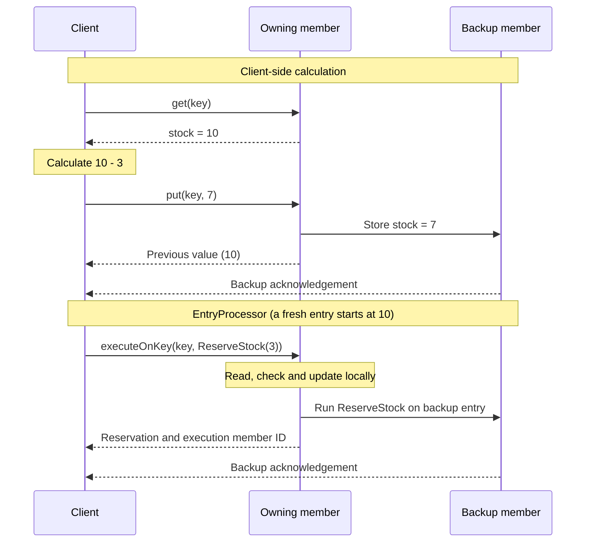
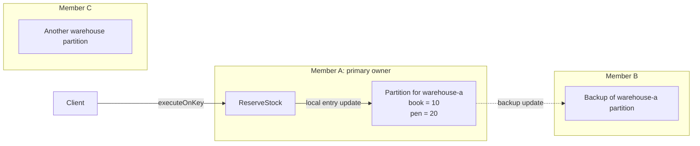

# Compute on data

When several clients read and update the same entry in a distributed map, a client-side read-modify-write takes separate calls and can lose concurrent updates. An `EntryProcessor` lets the member that owns the entry check and update it atomically in one operation.

The walkthrough compares both approaches using a warehouse stock reservation, then repeats the reservation after partition ownership moves to another member.

## Run it

Use **JDK 21** and **Maven 3.9 or newer**. The example runs locally with `com.hazelcast:hazelcast:5.7.0` (Community Edition).

From the example directory, run the walkthrough.

```sh
mvn compile exec:exec
```

Each run manages its own members and client. Members bind to loopback on available ports and use a unique cluster name.

To select JDK 21 on macOS, set `JAVA_HOME` before running Maven.

```sh
export JAVA_HOME=$(/usr/libexec/java_home -v 21)
```

Maven supplies Hazelcast's module-access flags to the walkthrough and test JVMs.

## The problem

The example models warehouse inventory for two products, books and pens. Each `IMap<StockKey, Integer>` entry stores the available quantity of one product at one warehouse. For example, `StockKey("warehouse-a", "book")` with a value of `10` represents ten books in stock at `warehouse-a`.

To reserve three books, the client can use a read-modify-write sequence.

```java
int available = stock.get(key);
if (available >= 3) {
    stock.put(key, available - 3);
}
```

The stock count crosses the network, and concurrent reservations can overwrite each other between `get` and `put`.

`executeOnKey` dispatches the reservation to the member that owns the entry.

```java
Reservation result = stock.executeOnKey(key, new ReserveStock(3));
```

`ReserveStock` checks and updates the supplied entry atomically.



The map uses one synchronous backup for both writes shown. The primary response and the backup acknowledgement can reach the Java client in either order. Once the primary response arrives, the client waits for any outstanding acknowledgement. The default backup timeout is 5 seconds (`hazelcast.client.operation.backup.timeout.millis`). If the acknowledgement is still missing at timeout, the client returns the primary result by default. See [Java client backup acknowledgement](https://docs.hazelcast.com/hazelcast/5.7/clients/java#configure-backup-acknowledgment).

## Partition related data together

Hazelcast divides map entries into partitions and assigns each partition to a member. Out of the box, a partition also has a backup on another member.

[`StockKey.getPartitionKey()`](src/main/java/com/hz/patterns/locality/StockKey.java) returns the warehouse. This places the separate book and pen entries for `warehouse-a` in the same partition.



This is one possible layout. The actual partition numbers and member IDs depend on the cluster. Different warehouses can hash to the same partition, so the walkthrough finds a warehouse with a different owner and prints its member ID.

The Java client sends `executeOnKey` over the network, and `ReserveStock` runs on the member that owns the book entry. An `EntryProcessor` works on the entry supplied to `process()`. Accessing another entry or data structure from the processor can deadlock, even when the entries share a partition. See [Hazelcast’s Entry Processor documentation](https://docs.hazelcast.com/hazelcast/5.7/data-structures/entry-processor).

Grouping by warehouse is useful for this lesson, but a very busy warehouse could become a hot partition. Choose the grouping key to match the work you need to keep together.

## What you will see

The walkthrough starts both approaches with ten books. Each reserves three, leaving seven. It prints the entry owner and the member that ran the processor; those IDs should match.

It then shuts down that owner gracefully. After the remaining members finish moving data and synchronizing backups, it reserves another two books. The result should show:

- A different owner from the first reservation.
- An execution member ID equal to the new owner.
- Stock changing from seven to five.

## Read the code

| File | What it explains |
| --- | --- |
| [ComputeOnData](src/main/java/com/hz/patterns/locality/ComputeOnData.java) | The client-side and owner-side approaches, followed by a member leaving |
| [StockKey](src/main/java/com/hz/patterns/locality/StockKey.java) | Full entry identity versus the partition key |
| [ReserveStock](src/main/java/com/hz/patterns/locality/ReserveStock.java) | The stock check and atomic entry update |
| [Reservation](src/main/java/com/hz/patterns/locality/Reservation.java) | The outcome, before/after values and execution member ID |
| [LocalCluster](src/main/java/com/hz/patterns/locality/LocalCluster.java) | Local member/client setup, ownership inspection and teardown |
| [ComputeOnDataTest](src/test/java/com/hz/patterns/locality/ComputeOnDataTest.java) | Module access, locality, concurrency, edge cases and migration |

`ReserveStock` implements `HazelcastInstanceAware` to report the UUID of the member executing the reservation. The injected member reference is `transient`.

`ReserveStock` uses Hazelcast's default `getBackupProcessor()`, which runs the same processor against the backup entry. The backup processor's return value is ignored.

The key, operation and result use Java serialization. All members share the example's classpath.

## Explore with the tests

```sh
mvn verify
```

| Test | What you can learn |
| --- | --- |
| `relatedKeysShareAPartitionButRemainDistinctEntries` | Colocation does not collapse two products into one entry; another warehouse can live elsewhere |
| `processorRunsOnOwnerAndMatchesUncontendedClientUpdate` | Both approaches return the same stock count without competing writers; the processor runs on the owner |
| `separateReadsAndWritesCanLoseAReservation` | Two callers can read the same last item and both believe they reserved it |
| `concurrentProcessorsCannotReserveMoreThanAvailable` | Of 30 requests for ten items, exactly ten succeed and stock stays nonnegative |
| `missingOrInsufficientStockIsNotChanged` | A rejection does not create or change stock; an exact reservation can reduce it to zero |
| `quantityMustBePositive` | Zero and negative requests are rejected |
| `reservationFollowsDataAfterOwnerLeaves` | Updated stock survives a graceful owner departure and computation follows the new owner |

The lost-reservation test uses a fixed interleaving: both callers read before either writes. This reproduces the race without relying on thread timing. The processor test submits multiple requests asynchronously.

To run just the migration test:

```sh
mvn -Dtest=ComputeOnDataTest#reservationFollowsDataAfterOwnerLeaves test
```

## What this guarantees

The check and decrement are atomic for one map entry during normal cluster operation. This does not make a multi-entry reservation transactional, provide CP consistency during a network partition, or make a repeated reservation idempotent. A new successful call reserves more stock.

Local execution does not mean zero network traffic: submission, results, backups and migration still use the network. The result includes the old and new counts for inspection; this is not a network benchmark.

The members are distinct Hazelcast instances communicating over loopback, but all run in one JVM. The departure is graceful, with operations before and after the move. This is not a test of a process crash, an in-flight request during failure or a whole-cluster outage. Map contents are in memory and disappear when the walkthrough finishes.

Entry processors should do short, nonblocking work. `ReserveStock` checks and updates the stock count on the partition thread.

## Next

Continue with the [local-compute learning path](../../docs/learning-paths.md#understand-local-compute). Check the [example list](../../README.md#examples) for availability.
