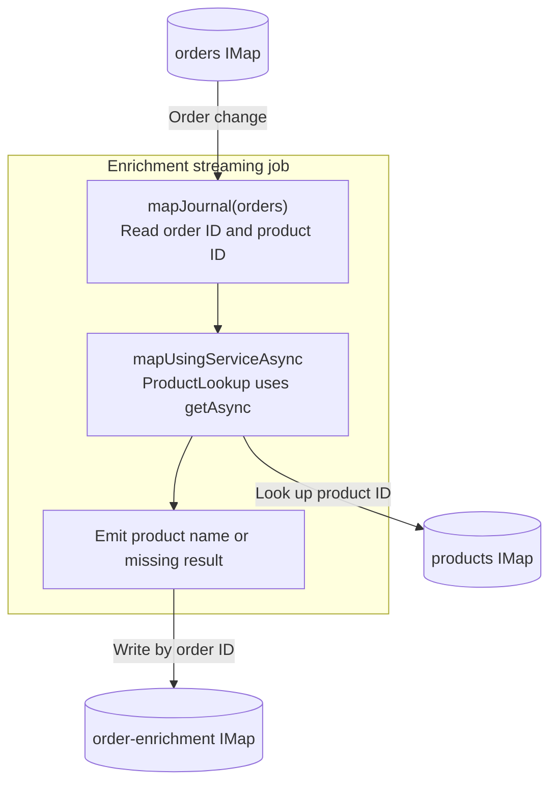
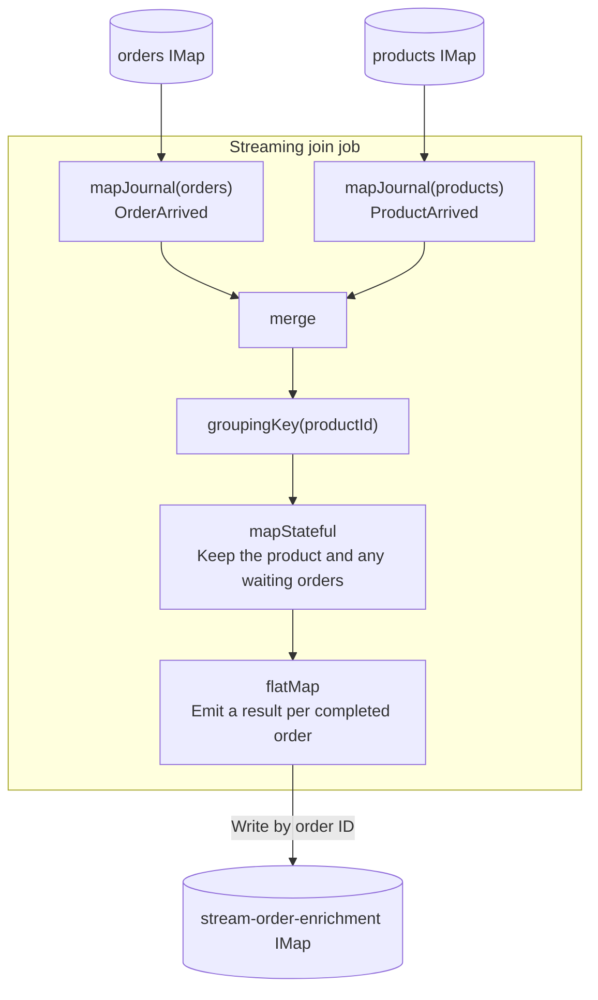

# Eventual joins

When data comes from independently updated sources, an event can arrive before the data needed to process it is available. This example compares two ways to handle that gap. A bounded async lookup retries against the current reference data. A stateful stream join matches events from both sources by key and completes once both have arrived, in either order.

The walkthrough enriches orders with product names. Both jobs process the same orders, including one whose product appears after the lookup has exhausted its retries.

## Run it

Use JDK 21 and Maven 3.9 or newer. The example runs on one embedded member with Hazelcast 5.7.0 Community Edition.

From this directory, run the walkthrough.

```sh
mvn compile exec:exec
```

The `orders` IMap maps order IDs to product IDs. The `products` IMap maps product IDs to names. The walkthrough inserts the notebook after the first lookup and the fountain pen after lookup retries have run out. The attempt count for the notebook can vary. Follow the sequence of writes in [EventualJoins.java](src/main/java/com/hz/patterns/eventualjoins/EventualJoins.java).

```text
Lookup order-1: JOINED Notebook after 2 attempts
Stream order-1: JOINED Notebook
Lookup order-2: PRODUCT_MISSING after 7 attempts
Stream order-2: JOINED Fountain pen
```

A map journal is a bounded history of changes to an IMap. Both jobs start at the oldest retained order event and then follow new changes. Only the stream join also reads the product journal. If an older product event has expired, the lookup can still find the current map entry, while the stream join needs another event for that product.

## Lookup with retries



In [JoinPipelines.lookupWithRetry](src/main/java/com/hz/patterns/eventualjoins/JoinPipelines.java), `mapUsingServiceAsync` allows eight in-flight lookups per processor. The stage can emit whichever lookup finishes first. Each pending retry keeps its slot, so enough missing products can still slow the input. The result goes to a separate map, and writing it produces no new event in the input journal. [Hazelcast asynchronous transforms](https://docs.hazelcast.com/hazelcast/5.7/pipelines/transforms#mapusingserviceasync)

[ProductLookup.java](src/main/java/com/hz/patterns/eventualjoins/ProductLookup.java) starts with an immediate `IMap.getAsync`. A missing product with attempts remaining schedules another read without sleeping on a Jet processing thread. The delay starts at 100 ms and doubles to a cap of 800 ms in the walkthrough. The limit bounds the number of reads, and each read is still subject to Hazelcast's invocation timing. A failed map call completes the lookup exceptionally. The processors for this stage share one lookup service and retry timer per member. Each order has its own future and attempt count. When Jet destroys the service, it stops the retry timer and completes any pending lookup futures exceptionally.

A product inserted after the last attempt can enrich a later order. The completed missing result stays in `order-enrichment` until another event for that order is processed or the result is changed by the application.

## Join two streams



[JoinPipelines.statefulStreamJoin](src/main/java/com/hz/patterns/eventualjoins/JoinPipelines.java) merges tagged events from both journals and routes events with the same product ID to one state object. An order can wait for its product, and a product can arrive first and serve later orders. A single product event can release several waiting orders, so `mapStateful` produces a batch of results and `flatMap` emits each one separately. The state clears the completed order IDs and retains the product. [ProductJoinState.java](src/main/java/com/hz/patterns/eventualjoins/ProductJoinState.java) · [Hazelcast stateful mapping](https://docs.hazelcast.com/hazelcast/5.7/pipelines/transforms#mapstateful)

Both output maps store a `JoinResult` by order ID. The streaming job reports zero lookup attempts because its product data comes from journal events. It reads retained and live adds and updates. Use a fresh ID for each order. The latest product name seen by the job applies to subsequent enrichments. Previously emitted results keep their name, and product removals are outside this example.

For this walkthrough, an unmatched order stays in memory until its product event arrives or the job stops. The job emits only completed joins, so a missing product can leave an order with no output and the wait has no time limit.

## Explore with the tests

```sh
mvn verify
```

The tests cover retry exhaustion and service shutdown, both event arrival orders, several orders sharing one product, and an unmatched order. They also check that the streaming job performs zero point reads of the product map. [EventualJoinsTest.java](src/test/java/com/hz/patterns/eventualjoins/EventualJoinsTest.java) · [ProductJoinStateTest.java](src/test/java/com/hz/patterns/eventualjoins/ProductJoinStateTest.java)

[Map journal workflow](../map-journal-workflow/README.md) · [All examples](../../README.md#examples)
