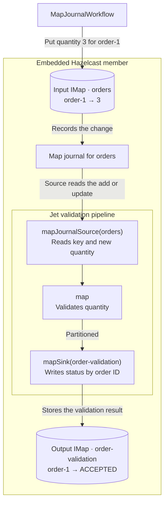

# Map journal workflow

Applications often need to trigger downstream work when stored data changes. A Hazelcast map journal records those changes as events, so a Jet job can process them as they arrive without polling the map.

In the walkthrough, each add or update in `orders` triggers validation in a Jet pipeline. The job writes the result to `order-validation`, keeping status writes out of the input journal.

## Run it

Use JDK 21 and Maven 3.9 or newer. The example uses Hazelcast 5.7.0 Community Edition and starts one embedded member on loopback.

From the example directory, run the walkthrough.

```sh
mvn compile exec:exec
```

Look for these lines among the Hazelcast logs.

```text
order-1 (quantity 3): ACCEPTED
order-2 (quantity 0): REJECTED
order-2 (quantity corrected to 2): ACCEPTED
```

The member starts standalone on an available loopback port, which can produce startup warnings about discovery and the seed port. After the third result, the walkthrough cancels the streaming job and shuts down the member.

## Follow an order

The `orders` map stores the requested quantity under the order ID. The validation pipeline checks whether the quantity is positive and writes `ACCEPTED` or `REJECTED` under the same ID in `order-validation`. Start with `validationPipeline()` in [MapJournalWorkflow.java](src/main/java/com/hz/patterns/journal/MapJournalWorkflow.java).



The walkthrough code and the embedded member run in the same JVM. The inner box shows the three stages of Jet's execution graph (DAG) using the names printed in the startup log. The edge into the sink routes results by order ID.

`START_FROM_OLDEST` starts at the oldest retained event in each partition's journal. That is how the job sees `order-1`, which was written before submission. The default source emits the key and new value for adds and updates and skips removals. Removing an order leaves its last validation result in place. The journal has finite capacity, and the output map can lag while Jet processes changes. [Hazelcast event journal](https://docs.hazelcast.com/hazelcast/5.7/data-structures/event-journal) and [map journal source](https://docs.hazelcast.com/hazelcast/5.7/integrate/map-connector#map-as-a-streaming-source).

## Explore with the tests

```sh
mvn verify
```

[MapJournalWorkflowTest.java](src/test/java/com/hz/patterns/journal/MapJournalWorkflowTest.java) verifies that the pipeline reads a retained add even after the input entry was removed, and that a live update changes an order's result from `REJECTED` to `ACCEPTED` while leaving the input quantities in `orders`.

## Extensions to try

- Enable the journal on `order-validation` and read it from a second job to count validation events over time. A corrected order can contribute both a rejection and an acceptance.
- Store quantity and status in one value in `orders`. Mark each quantity change as pending and validate only pending entries. Apply a result only if it matches the current order revision. Once the result clears the pending status, its journal event is filtered out.
- Run on a cluster with several members and observe how the job behaves when a member leaves or joins. The walkthrough uses a single in-memory member, so recovery is a separate exercise.

Continue with the [learning paths](../../docs/learning-paths.md).
