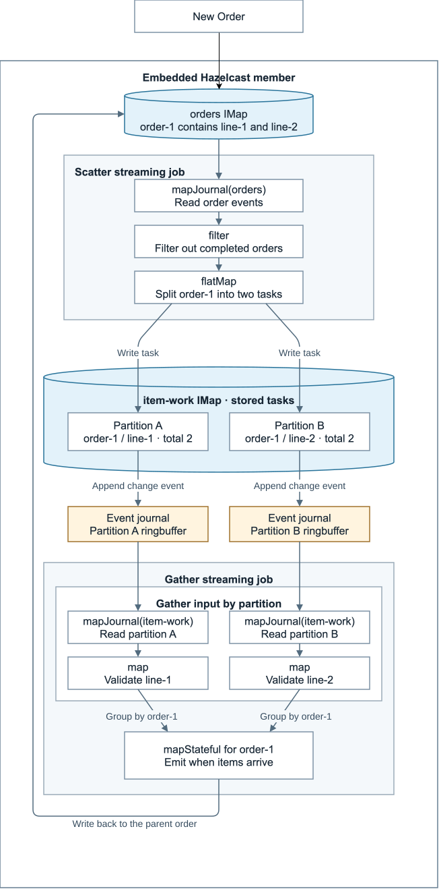

# Scatter/gather

The scatter job splits each order into line tasks. The gather job validates the lines independently and writes the result back to `orders` only after every line has a result. An order is rejected if any line has a nonpositive quantity.

## Run it

Use JDK 21 and Maven 3.9 or newer. The example runs on a single embedded member with Hazelcast 5.7.0 Community Edition.

From the example directory, run the walkthrough.

```sh
mvn compile exec:exec
```

Look for these results among the Hazelcast logs.

```text
order-1: ACCEPTED after gathering 2 lines
order-2: REJECTED after gathering 2 lines
```

The walkthrough submits the second order after the first has completed. Both streaming jobs stay running between orders. The second order has a line with quantity zero, and its final result includes the outcome for both lines.

## Follow an order

Each `orders` entry contains a list of line items. The scatter job reads the map journal and uses `flatMap` to publish one `ItemTask` per line to `item-work`, keyed by `(orderId, itemId)`. Every task carries the total number of lines in its order. A line with quantity `2` is still one task. Submit each order once under a fresh ID and use unique line IDs within it.

Follow `order-1` as its book and pen lines fan out and come back together. The diagram shows one possible partition placement. In this walkthrough, all partitions belong to the same embedded Hazelcast member.



The full `(orderId, itemId)` key determines where the single `item-work` IMap stores each task. Sibling lines can land in different partitions or share one. Writing a task also appends a change event to that partition's journal ringbuffer. Gather reads those events from the partition owners. [Hazelcast event journal](https://docs.hazelcast.com/hazelcast/5.7/data-structures/event-journal)

After validation, `groupingKey(orderId)` routes both line results to the same gather state even if they came from different partitions. On a cluster with multiple members, that step can move results between members. `GatherState` records each line ID once, and `mapStateful` returns `null` until the count reaches the expected total. It then emits the completed result and Jet deletes the accumulator. An entry processor attaches the result to the original order. [ScatterGather.java](src/main/java/com/hz/patterns/scattergather/ScatterGather.java) · [GatherState.java](src/main/java/com/hz/patterns/scattergather/GatherState.java) · [Hazelcast stateful mapping](https://docs.hazelcast.com/hazelcast/5.7/pipelines/transforms#mapstateful)

The write-back creates an update in the `orders` journal. Scatter only processes orders whose result is empty, so the completed update stops at the filter. The entry processor only writes to an existing pending order, so a replayed result leaves completed orders and removed orders alone. Incomplete orders stay in memory until they complete or the job stops.

## Explore with the tests

```sh
mvn verify
```

The tests follow retained and live orders through both jobs, check that the completed update does not dispatch more work, and exercise the completion gate with an out-of-order line, a duplicate, and a missing line. They also cover conflicting counts and invalid parent orders. [ScatterGatherTest.java](src/test/java/com/hz/patterns/scattergather/ScatterGatherTest.java)
